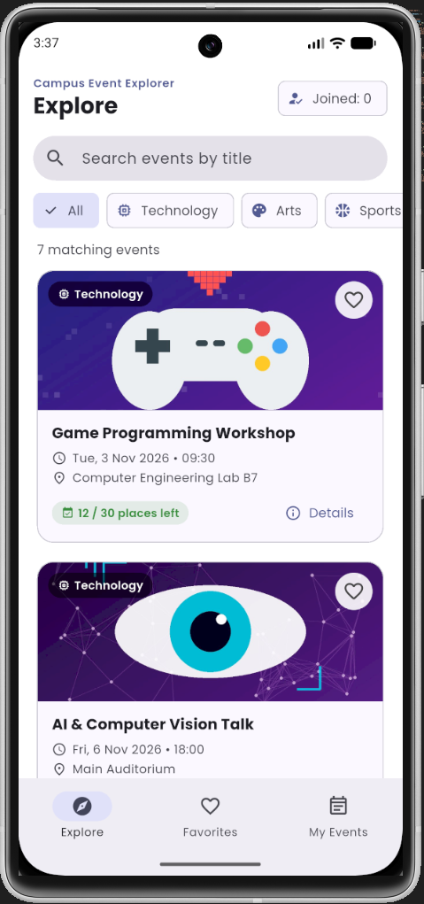
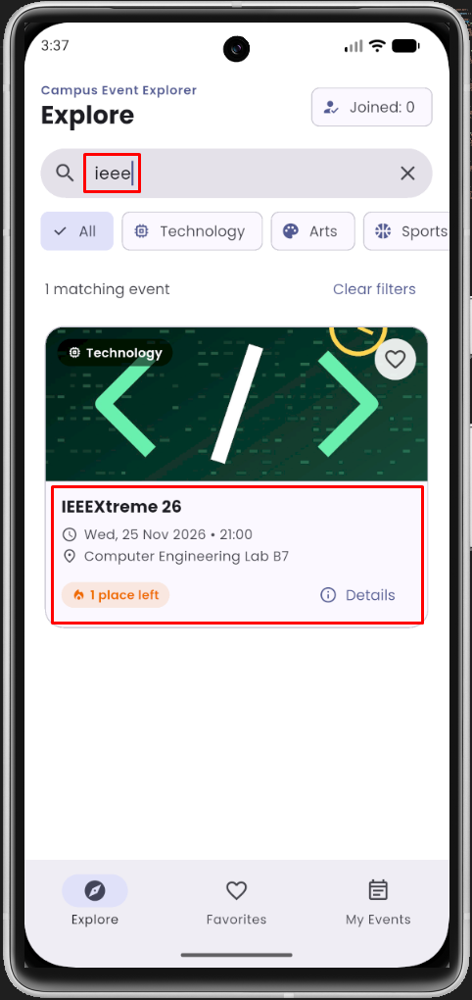
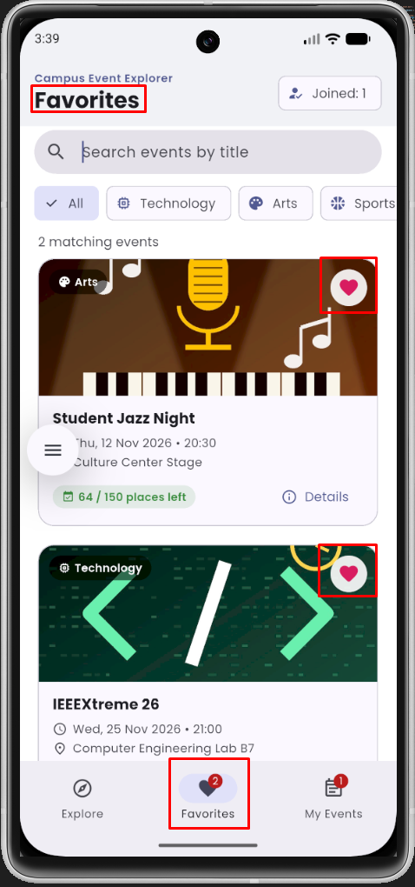
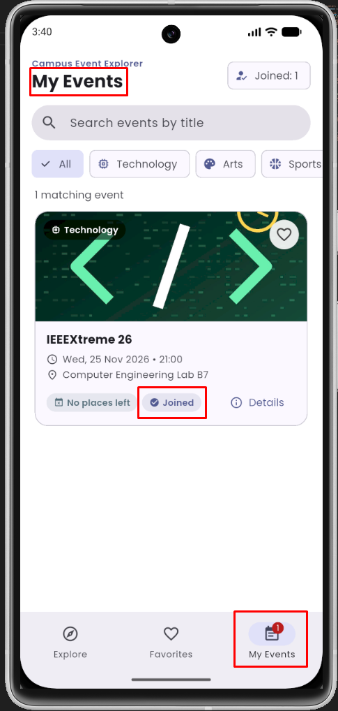
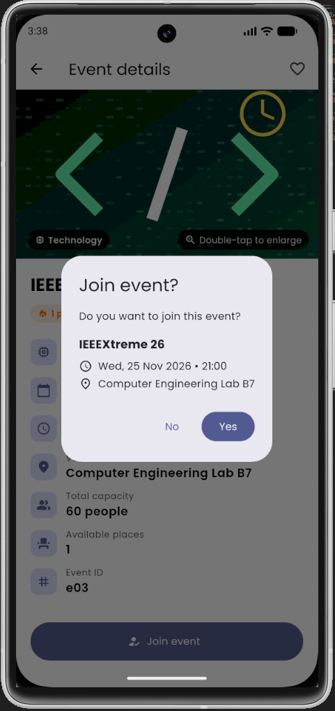
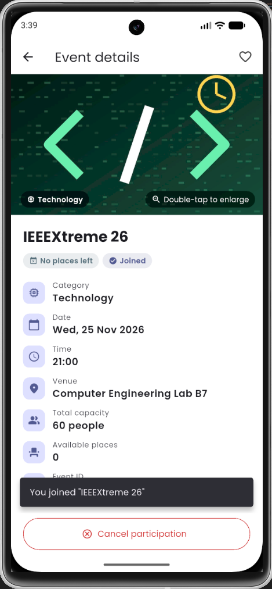
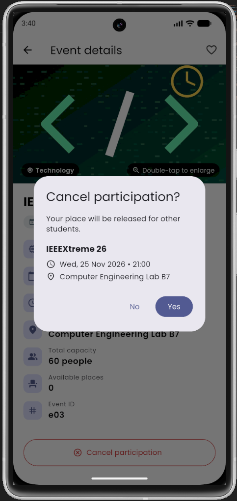
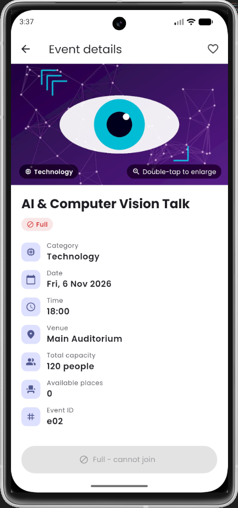
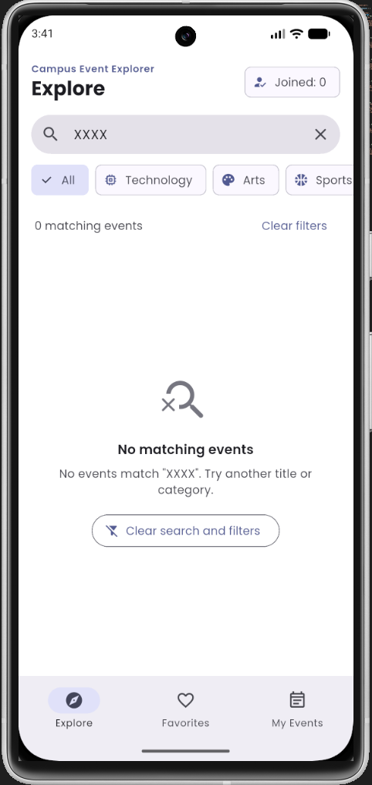

# Campus Event Explorer

Mobile Programming 1 · Assignment #1

A Flutter app that helps students discover campus events, save favorites and manage their own participation. All data is fictional and lives in the Dart code, so the app works offline after installation.

## Team

| Full name | Student ID    |
| --------- | ------------- |
| Berk Cüce | `29917851574` |

## Flutter version

```
Flutter 3.47.6 • channel stable • https://github.com/flutter/flutter.git
Framework • revision 5fc346839b (3 weeks ago) • 2026-09-30 15:02:49 -0700
Engine • hash b8c8d3d8d5d0095127057f8a29ca8cc53da2167c (revision 692136cb65) (22 days ago) • 2026-09-30 00:56:59.000Z
Tools • Dart 3.13.5 • DevTools 2.60.0
```

## Setup and run

```bash
flutter --version      # must show 3.47.6, channel stable
flutter pub get
flutter run            # with an Android emulator or device connected
flutter test           # unit + widget tests
```

Optional release APK: `flutter build apk --release` (output: `build/app/outputs/flutter-apk/app-release.apk`).
A prebuilt release APK (arm64, armv7 and x86_64) is attached to this repository's **Releases** page.

## Features

- **Explore:** 7 events in 4 categories (Technology, Arts, Sports, Social), shown as cards with image, title, category, date/time, venue, availability label, favorite button and a Details button.
- **Search and filter:** title search that ignores letter case and surrounding spaces, a clear (×) button, and category chips (All + 4 categories). They work together, show the number of matching events, and apply to all three views.
- **Details:** all event information, a favorite button and a participation button. Double-tapping the image opens a full-screen viewer (pinch to zoom). Both screens use normal Back navigation.
- **Favorites / My Events:** a bottom navigation bar with badges. Each view has its own empty-state message.
- **Join / Cancel:** a confirmation dialog shows the title, date/time and venue with Yes/No options. Yes joins once and takes one place. A joined event offers _Cancel participation_ with its own confirmation, which restores the place. Full events are marked **Full** and cannot be joined. The total number of joined events is shown in the app bar.
- **State:** a plain Dart class (`EventStore`) owned by `HomeScreen` and updated with `setState`. No state-management packages are used. State resets when the app restarts, as the assignment allows.

Special data cases: _AI & Computer Vision Talk_ (`e02`) starts full. _IEEEXtreme 26_ (`e03`) starts with exactly one place. All dates are in November 2026, after the deadline.

## Project structure

```
lib/
  main.dart                       MaterialApp, theme, custom font
  models/campus_event.dart        CampusEvent + EventCategory
  data/sample_events.dart         fictional event data
  state/event_store.dart          places, favorites, joins, shared filters
  utils/date_format.dart          date/time formatting
  screens/
    home_screen.dart              StatefulWidget: tabs, search/filter, lists
    event_details_screen.dart     StatefulWidget: details, favorite, join/cancel
    image_viewer_screen.dart      enlarged image
  widgets/                        reusable StatelessWidgets
    event_card.dart, availability_label.dart, favorite_button.dart,
    search_filter_bar.dart, empty_state.dart, confirm_dialog.dart
assets/
  images/                         7 event illustrations
  fonts/                          Poppins (Regular, SemiBold, Bold) + OFL.txt
test/
  event_store_test.dart           logic tests
  widget_test.dart                UI flow tests
tool/make_images.py               script that generated the illustrations
```

## Screenshots

| Explore                                  | Details                                  | Favorites                                    | My Events                                    |
| ---------------------------------------- | ---------------------------------------- | -------------------------------------------- | -------------------------------------------- |
|  |  |  |  |

| Join dialog                               | After joining                          | Cancel dialog                                 | Full event                               | Empty search                                |
| ----------------------------------------- | -------------------------------------- | --------------------------------------------- | ---------------------------------------- | ------------------------------------------- |
|  |  |  |  |  |

## Test checklist

| Case                        | How it was checked                                                                               | Result |
| --------------------------- | ------------------------------------------------------------------------------------------------ | ------ |
| Full event                  | Opened _AI & Computer Vision Talk_: label shows **Full**, button disabled ("Full - cannot join") | ✓      |
| Join dialog – No / dismiss  | Join → No (and tapping outside): places and My Events unchanged                                  | ✓      |
| Join dialog – Yes           | _IEEEXtreme 26_: 1 → 0 places, SnackBar shown, appears in My Events, "Joined: 1"                 | ✓      |
| No duplicate join           | After joining, the button changes to _Cancel participation_. Places do not decrease again        | ✓      |
| Cancel dialog               | Cancel participation → Yes: removed from My Events, place restored (0 → 1).                      | ✓      |
| Last place can be cancelled | Joined the last place of IEEEXtreme 26, then cancelled successfully.                             | ✓      |
| Empty search                | Searched "xxxx": "No matching events" message and _Clear search and filters_ button.             | ✓      |
| Search + category           | " ING " → 2 results. + Social → 1. + Arts → empty state.                                         | ✓      |
| Favorites consistency       | Heart on card / details updates Explore, Favorites and details. Capacity unchanged.              | ✓      |
| Image viewer                | Double-tap on the details image opens the enlarged image. Back returns.                          | ✓      |
| Automated tests             | `flutter test` passes.                                                                           | ✓      |

## Asset credits and licenses

- **Images** (`assets/images/*.jpg`): original illustrations generated programmatically for this project with `tool/make_images.py` (Python + Pillow); no third-party images are used.
- **Font:** [Poppins](https://github.com/itfoundry/Poppins) by Indian Type Foundry / Jonny Pinhorn, © 2020 The Poppins Project Authors, under the SIL Open Font License 1.1. The license is included at `assets/fonts/OFL.txt`.
- **Icons:** Material Icons, included with Flutter (Apache License 2.0).

## Known limitations

- Favorites and participation are kept in memory only and reset when the app restarts, as the assignment allows.
- There are no user accounts, backend, real bookings or notifications; all events are fictional.
- The UI is in English and is designed for phone screens in portrait orientation.
